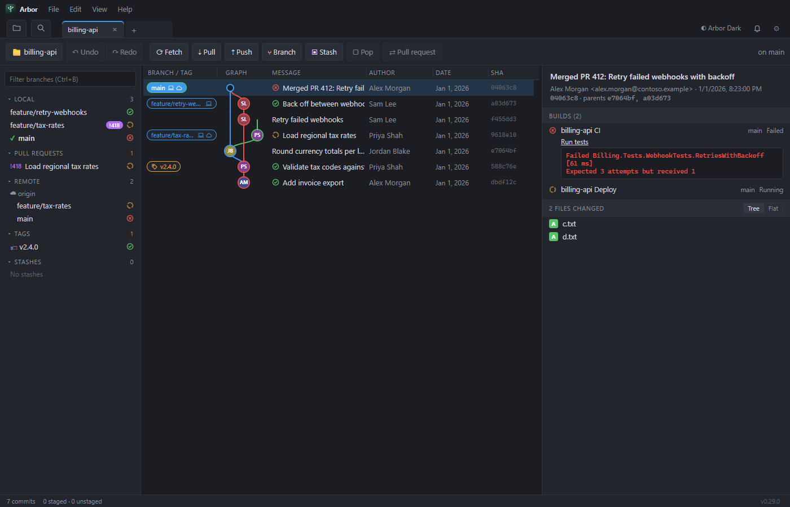
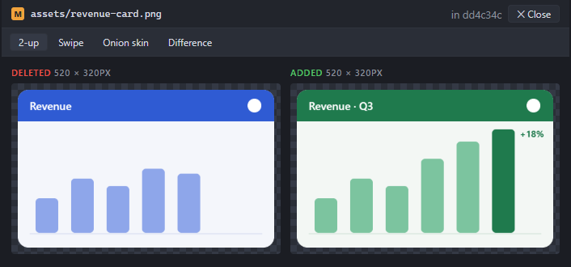
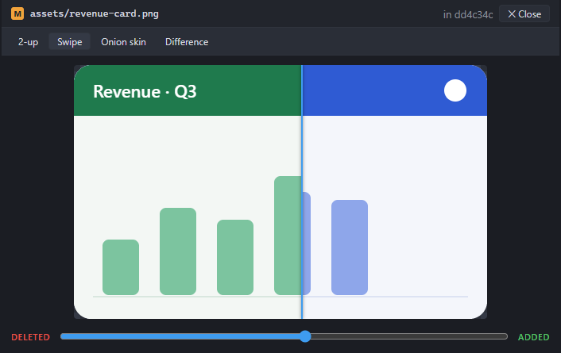
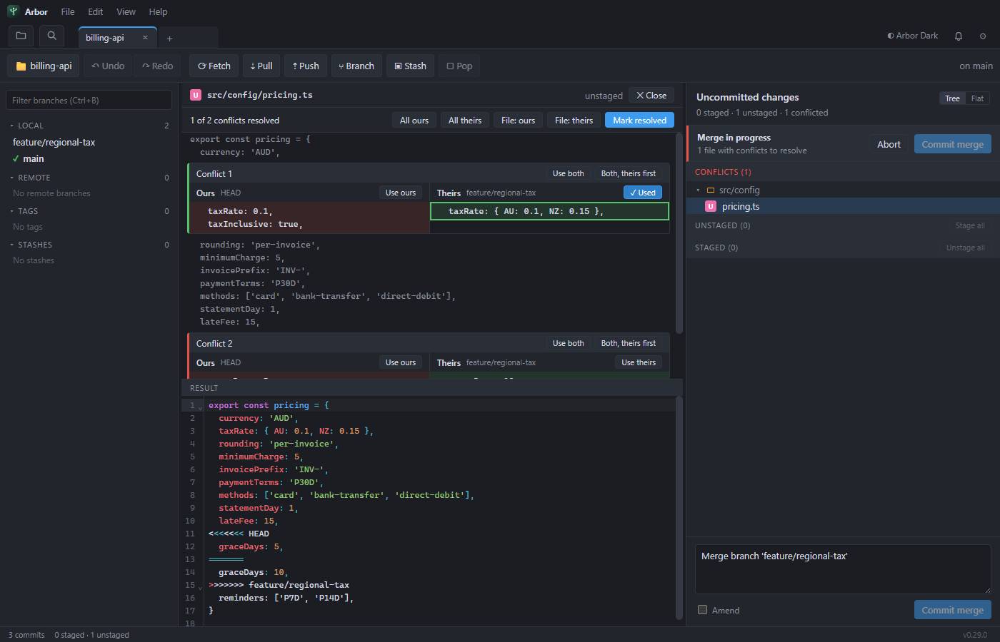
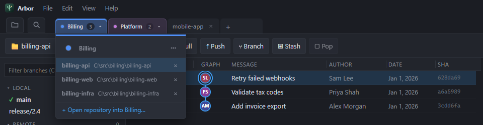
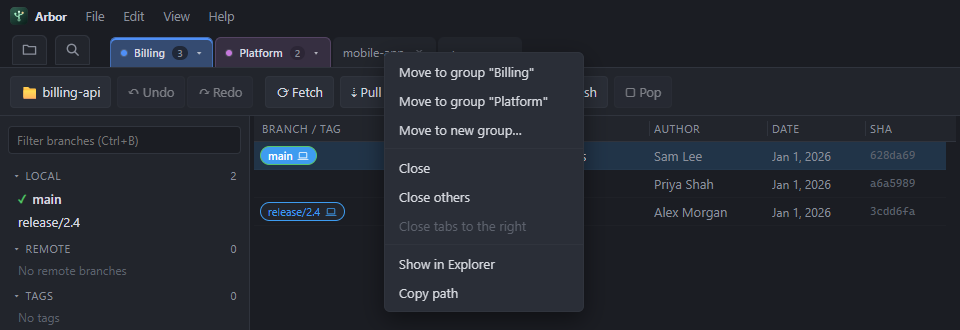
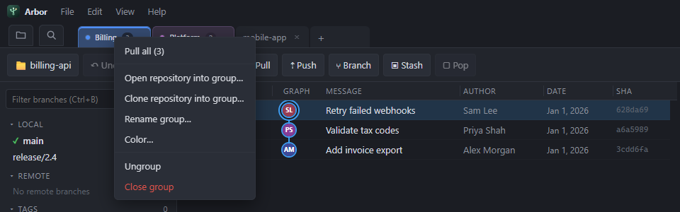

<p align="center">
  
</p>

<h1 align="center">Arbor</h1>

<p align="center">
  <strong>The desktop git client for teams on Azure DevOps, GitHub and GitLab.</strong><br>
  Branches, pull requests and pipelines across every repository you own, in one fast app for Windows, macOS and Linux.
</p>

<p align="center">
  <a href="https://github.com/nmclauchlan/arbor/releases/latest">Download</a> ·
  <a href="#features">Features</a> ·
  <a href="#organise-repositories-with-tab-groups">Tab groups</a> ·
  <a href="#connect-your-hosts">Connect your hosts</a> ·
  <a href="#security-and-privacy">Security and privacy</a> ·
  <a href="#keyboard-shortcuts">Shortcuts</a>
</p>


## Why Arbor

Engineering teams rarely work in one repository. A typical day spans an API, a front end, shared libraries and infrastructure, each with its own branches, reviews and pipelines spread across browser tabs. Arbor brings all of it into one place:

- **Code, reviews and CI together.** Pull requests, reviewers and build results sit next to the commit graph, so you know whether a branch is green before you merge it.
- **Built for many repositories.** Tab groups, a Repository Management home screen, bulk fetch and pull, and a Ctrl+P switcher keep dozens of repositories in reach.
- **Safe by design.** Commits, checkouts, merges, resets and more can be undone with Ctrl+Z. Conflicts are resolved side by side. Destructive actions ask first.
- **Works with the git you already have.** Arbor drives your installed git, so your config, credential helpers, SSH keys and hooks work exactly as they do on the command line.

## Features

### Built for teams on Azure DevOps, GitHub and GitLab

Connect Azure DevOps Services, GitHub.com, GitHub Enterprise Server, GitLab.com or a self-managed GitLab instance, and Arbor becomes a front end for your team's workflow:

- Open pull and merge requests appear in the sidebar and as badges on their branches, with reviewers and votes, checks, merge state and a link to the browser.
- Create a pull request for the current branch from the toolbar, or start one from any branch's context menu.
- Clone any repository you can access from a searchable list, optionally straight into a tab group.
- Copy links to branches and commits on your host from their context menus.
- Commit messages and pull request descriptions render as Markdown, with headings, lists, code, tables and links.

### See CI before you merge



Arbor shows build status from Azure Pipelines, GitHub Actions and checks, and GitLab CI everywhere you look:

- **On the graph.** Every recent commit carries a passed, failed or running marker. Hover for each pipeline's result.
- **In the sidebar.** Local and remote branches, pull requests and tags show the status of their latest commit.
- **Failures explained.** Select a commit to see its builds and why they failed: failed Azure Pipelines tasks and their errors, GitHub check annotations, or the failed GitLab job and the end of its log. Each links straight to the run.
- **Live while it runs.** Running builds refresh every 20 seconds, and status refreshes straight after you push.

### Stay ahead of your team

Arbor fetches your open repositories in the background, every ten minutes by default, and the bell in the title bar tells you what changed:

- **New commits** on the remote branches you track, listed by repository. One entry covers every local branch that tracks the same remote branch. Only commits that land after Arbor starts watching a branch count as new, so a branch you rarely pull won't bury you in old history.
- **Failed builds** on the latest commit of those remote branches. Click one to open the commit with its errors.
- Jump to any commit in the graph, pull with one click, or clear entries (individually or all at once) until something new arrives.

### Work across dozens of repositories

- **Repository Management** (Ctrl+T) lists your open, favourite and recent repositories with their project, current branch, how far each is ahead or behind, and how many files have changed. Search them, star favourites, and fetch or pull many at once.
- **Go to repository** (Ctrl+P) finds any open, favourite or recent repository as you type and jumps straight to it.
- **Tab groups** gather related repositories under one named, colour-coded tab. Pull a whole group with one click. See [Organise repositories with tab groups](#organise-repositories-with-tab-groups).
- **Fast to open.** Arbor restores your tabs on launch but only loads a repository when you open its tab, so even a large workspace opens quickly.

### A complete git toolkit

- **The graph.** Every branch, remote and tag on one graph with coloured lanes, merge curves and author avatars. Branches and tags have their own column, and each commit can preview the start of its description. Drag column edges to resize them, or double-click an edge to fit the column to its content.
- **Everything one right-click away.** From a commit, a branch or tag badge, or a sidebar entry you can:
  - check out any branch, including a remote branch when your local copy is behind it;
  - pull and push branches you haven't checked out;
  - fast-forward, merge, rebase, cherry-pick and revert;
  - reset (soft, mixed or hard) and create branches, tags and worktrees;
  - rename or delete a branch locally and on the remote;
  - save a patch, and solo or hide branches in the graph.
- **Changes.** Stage, unstage and discard per file, per folder or everything at once, in a folder tree or flat list. Click a file to see its diff, double-click to edit it in place with syntax highlighting, and commit with Ctrl+Enter.

### See exactly what changed in an image

Design and asset changes deserve better than "binary file changed". Select any changed image, in a commit or in your uncommitted work, to compare the two versions four ways:

- **2-up** shows the old and new versions side by side with their dimensions.
- **Swipe** drags a divider across the image to reveal one version over the other.
- **Onion skin** fades smoothly between the two.
- **Difference** blends them so only changed pixels show; anything identical appears black.





### Resolve merge conflicts without leaving Arbor

When a merge, cherry-pick, revert or rebase stops on conflicts, a banner shows the operation in progress and the changes panel lists every conflicted file. Open one to work through it:

- Each conflict shows your side (HEAD) and theirs (the incoming branch) next to each other.
- Resolve a conflict with **Use ours**, **Use theirs**, **Use both** or **Both, theirs first**, or settle every conflict at once with **All ours** or **All theirs**.
- Take the whole file from either side with **File: ours** or **File: theirs**.
- The merged result is a full editor with syntax highlighting, so you can adjust it before choosing **Mark resolved**.
- **Commit merge** (or **Continue** for a rebase, cherry-pick or revert) and **Abort** sit in the same banner.



### Safe by design

- **Undo and redo** (Ctrl+Z and Ctrl+Shift+Z) reverse commits, amends, checkouts, branch creation and deletion, resets, merges, pulls, cherry-picks and reverts. Arbor checks the repository hasn't moved on before reversing anything, and never discards uncommitted work.
- **Confirmation first.** Resets, discards, and deleting branches, tags or stashes ask before they run.
- **No surprises.** Merges that hit conflicts stop and show the conflicts, and pulls from notifications only ever fast-forward.

### Make it yours

Ten themes, dark and light, including Dracula, Nord, Solarized, Gruvbox, Monokai and Rosé Pine. Resize the sidebar, panels and graph columns, choose tree or flat file lists, toggle avatars and description previews, and set how often repositories refresh and how much history to load. Settings live under ⚙ or Ctrl+,.

## Organise repositories with tab groups

Tab groups keep related repositories together: a product's API, web app and infrastructure, or the repositories one team owns.



**Create a group.** Click **+** at the end of the tab bar, choose **New group…** and name it. You can also right-click any repository tab and choose **Move to new group…**.

**Add repositories.** Any of these works:

- Drag a repository tab onto the group.
- Right-click a tab and choose **Move to group "…"**.
- Open the group and choose **+ Open repository into …**. You can pick several folders at once.
- Right-click the group and choose **Clone repository into group…** to clone straight from your host.



**Switch between repositories.** Click a group to drop down its repositories, then click one to open it. The group holding the repository you have open is highlighted, and its list marks which one is open. Ctrl+P jumps to any repository directly.

**Manage the group.** Right-click a group, or use **⋯** in its list:

- **Pull all** fast-forwards every repository in the group and reports the outcome for each.
- **Open repository into group…** and **Clone repository into group…** add more repositories.
- **Rename group…** and **Color…** change its name and colour. Pick a swatch, enter a hex colour, or import a palette from a Color Hunt link.
- **Ungroup** turns its repositories back into ordinary tabs, and **Close group** closes them all.



Drag groups and tabs to reorder them. Groups, their colours and your open tabs are restored the next time you start Arbor.

## Download

Download the latest version from the [releases page](https://github.com/nmclauchlan/arbor/releases/latest):

| Platform | Package |
| --- | --- |
| Windows | `Arbor-<version>-win-x64.exe` installer |
| macOS | `Arbor-<version>-mac-<arch>.dmg` |
| Linux | `.AppImage` or `.deb` |

Installed builds keep themselves up to date. Arbor checks for new versions in the background, downloads them, and offers a restart from the status bar. The version number sits at the bottom right of the window; right-click it to check for updates on demand, read the release notes or copy the version. Automatic checks can be turned off in Settings.

## Connect your hosts

Open **Settings → Accounts**, choose the service, enter its address and paste a personal access token:

| Service | Address | Token access |
| --- | --- | --- |
| Azure DevOps Services | `https://dev.azure.com/your-org` or `https://your-org.visualstudio.com` | Code (read and write) and Build (read) |
| GitHub and GitHub Enterprise Server | `https://github.com` or `https://github.your-company.com` | Repositories, pull requests, checks and commit statuses |
| GitLab and self-managed GitLab | `https://gitlab.com` or `https://gitlab.your-company.com` | The `api` scope |

Arbor matches each repository to an account through its `origin` remote. If a token can't read build results, the commit panel says which scope to add rather than failing quietly.

## Security and privacy

- **Your git, your rules.** Arbor runs the git executable on your machine (or the one you choose in Settings), so repository access goes through your existing credential helpers and SSH keys, and your hooks run as usual.
- **Tokens stay protected.** Personal access tokens are encrypted with your operating system's credential store where available, and are only ever sent to the host they belong to.
- **No analytics.** Arbor contains no usage tracking. It connects only to:
  - your git remotes;
  - the hosts you connect;
  - GitHub Releases, to check for updates;
  - Gravatar and GitHub, for author pictures, looked up by a hash of each author's email.

  Update checks and author pictures can both be turned off in Settings.

## Keyboard shortcuts

On macOS, use ⌘ in place of Ctrl.

| Shortcut | Action |
| --- | --- |
| Ctrl+T | Repository Management |
| Ctrl+P | Go to a repository |
| Ctrl+O | Open a repository |
| Ctrl+W | Close the current tab |
| Ctrl+Tab / Ctrl+Shift+Tab | Next / previous tab |
| Ctrl+B | Filter branches |
| Ctrl+Z / Ctrl+Shift+Z | Undo / redo the last git action |
| Ctrl+Enter | Commit |
| Ctrl+S | Save the file being edited |
| Ctrl+, | Settings |
| Ctrl+= / Ctrl+- / Ctrl+0 | Zoom in / out / reset |
| F11 | Full screen |
| Esc | Back to the graph, close menus and dialogs |

## Building from source

Arbor is built with Electron, React and TypeScript, and drives the `git` on your PATH.

```bash
npm install
npm run dev
```

Pass a repository path to open it on launch:

```bash
npx electron . C:\path\to\repo
```

- `npm run typecheck` runs the TypeScript checks for the main, preload and renderer projects
- `npm run build` produces `out/`
- `npm run dist` builds installers for the current platform into `release/`
- `npm run icon` re-renders `build/icon.svg` to `build/icon.png`

### Testing

End-to-end tests drive the built app with [Playwright](https://playwright.dev) against throwaway repositories, so they never touch your own data. Azure DevOps, GitHub and GitLab responses are simulated, so no accounts or network access are needed:

```bash
npm run test:e2e
```

The suite covers:

- the commit graph, sidebar and column layout;
- staging, committing, discarding and editing files;
- branch, commit and tag context menus, including undo and redo;
- merge conflict resolution;
- tab groups and Pull all;
- the repository switcher and Repository Management;
- incoming-commit and failed-build notifications;
- build status for all three hosts;
- Markdown rendering;
- the update menu.

CI runs it on every push.

### Layout

- `src/main` Electron main process. `git.ts` wraps the git CLI; `hosts/` holds the Azure DevOps, GitHub and GitLab clients and stores accounts; `index.ts` creates the window and exposes each function over IPC; `updater.ts` handles updates.
- `src/preload` bridges those IPC channels to `window.git`, `window.host`, `window.updater` and `window.native`.
- `src/shared/types.ts` types shared by both sides, including the `GitApi` and `HostApi` contracts.
- `src/renderer/src` React UI. `graph/layout.ts` lays out the commit graph; `components/` holds the panels, the file viewer, the editor, the tab bar and notifications.
