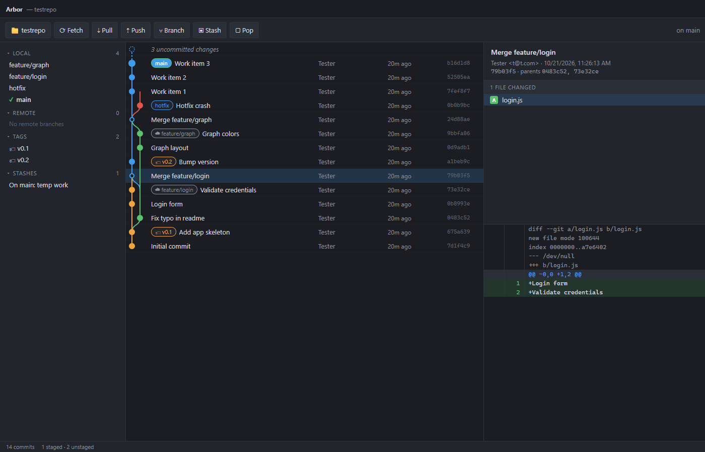

<p align="center">
  
</p>

<h1 align="center">Arbor</h1>

<p align="center">A GitKraken-style desktop git client built with Electron, React and TypeScript. Branches grow in lanes; Arbor keeps them in order.</p>



## Download

Installers for Windows, macOS and Linux are published on the [releases page](https://github.com/nmclauchlan/arbor/releases). Every push to `main` builds and publishes a release for the version in `package.json`, so bump the version to cut a new one.

## Features

- Tabs for multiple open repositories, restored on next launch (Ctrl+O open, Ctrl+W close, Ctrl+Tab switch)
- Inline CodeMirror editor for any file in the working tree or a commit, with syntax highlighting and Ctrl+S to save
- Commit graph with coloured lanes, merge curves and ref badges (branches, remotes, tags, HEAD)
- Working tree panel: stage/unstage/discard files, view diffs, commit and amend (Ctrl+Enter)
- Commit details with changed-file list and unified diff viewer
- Image comparisons for changed images: 2-up, swipe, onion skin and difference modes
- Sidebar with local branches (ahead/behind), remote branches, tags and stashes
- Toolbar actions: fetch, pull, push (sets upstream when missing), create branch, stash, pop
- Context menus: checkout, merge, create branch here, delete branch, cherry-pick, revert, reset (soft/mixed/hard), copy SHA
- Recent repositories on the welcome screen
- Live refresh of status and refs every few seconds and on window focus

## Development

```bash
npm install
npm run dev
```

Pass a repository path to open it on launch:

```bash
npx electron . C:\path\to\repo
```

Other scripts:

- `npm run typecheck` runs the TypeScript checks for the main, preload and renderer projects
- `npm run build` produces `out/`
- `npm run dist` builds installers for the current platform into `release/`
- `npm run icon` re-renders `build/icon.svg` to `build/icon.png`

## Releases

The [release workflow](.github/workflows/release.yml) runs on every push to `main`. It type-checks and builds, then runs electron-builder on Windows, macOS and Linux and publishes the installers to a GitHub release tagged with the package version. macOS builds are unsigned.

## Layout

- `src/main` Electron main process. `git.ts` wraps the git CLI via simple-git; `index.ts` creates the window and exposes each git function over IPC as `git:<name>`.
- `src/preload` bridges those IPC channels to `window.git` in the renderer.
- `src/shared/types.ts` types shared by both sides, including the `GitApi` contract.
- `src/renderer/src` React UI. `graph/layout.ts` assigns lanes and edges for the commit graph; `components/` holds the panels.
